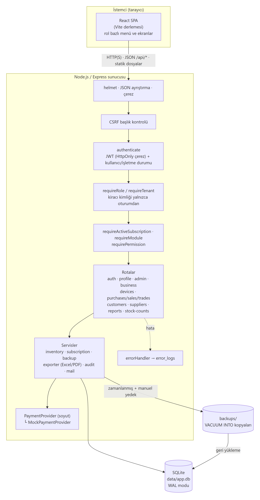
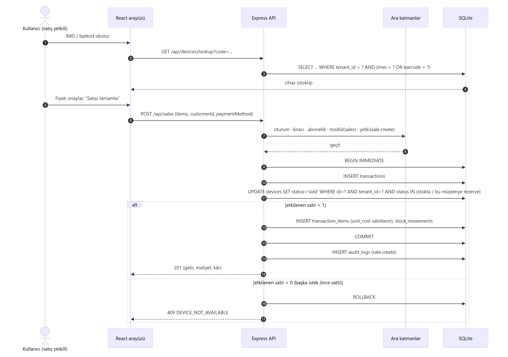
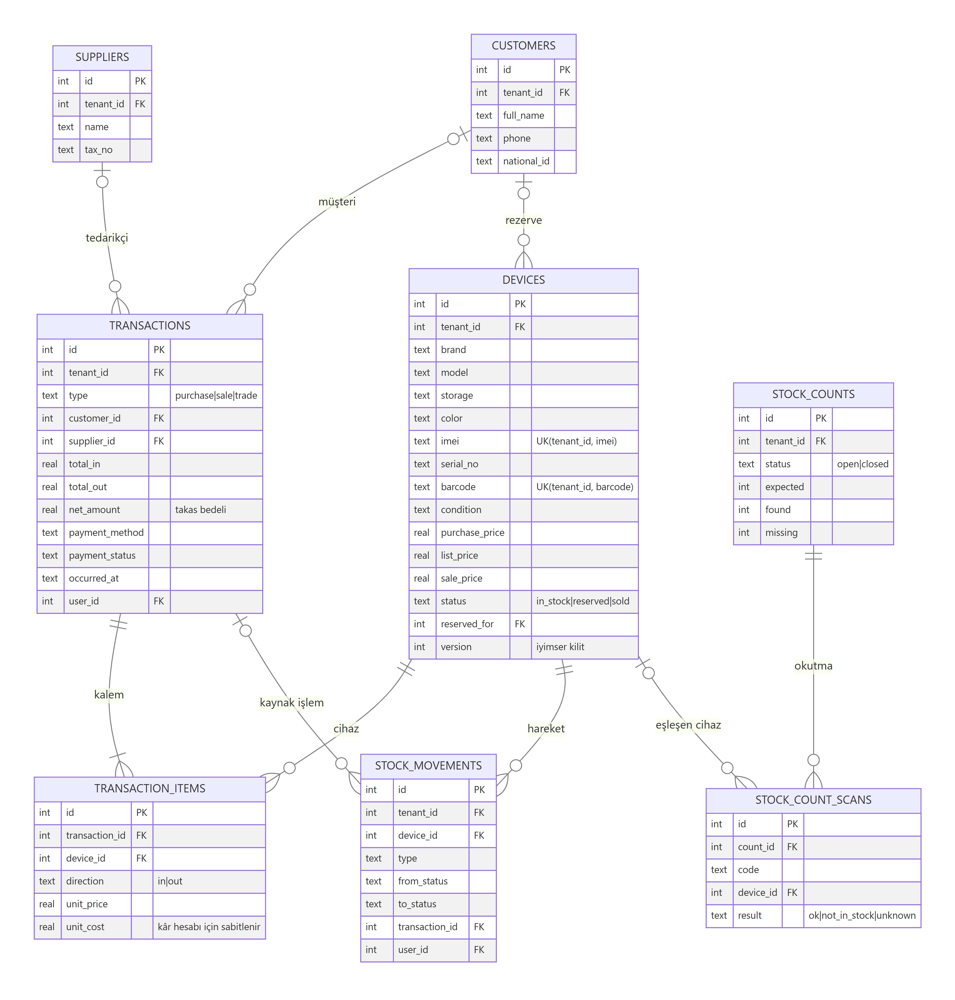
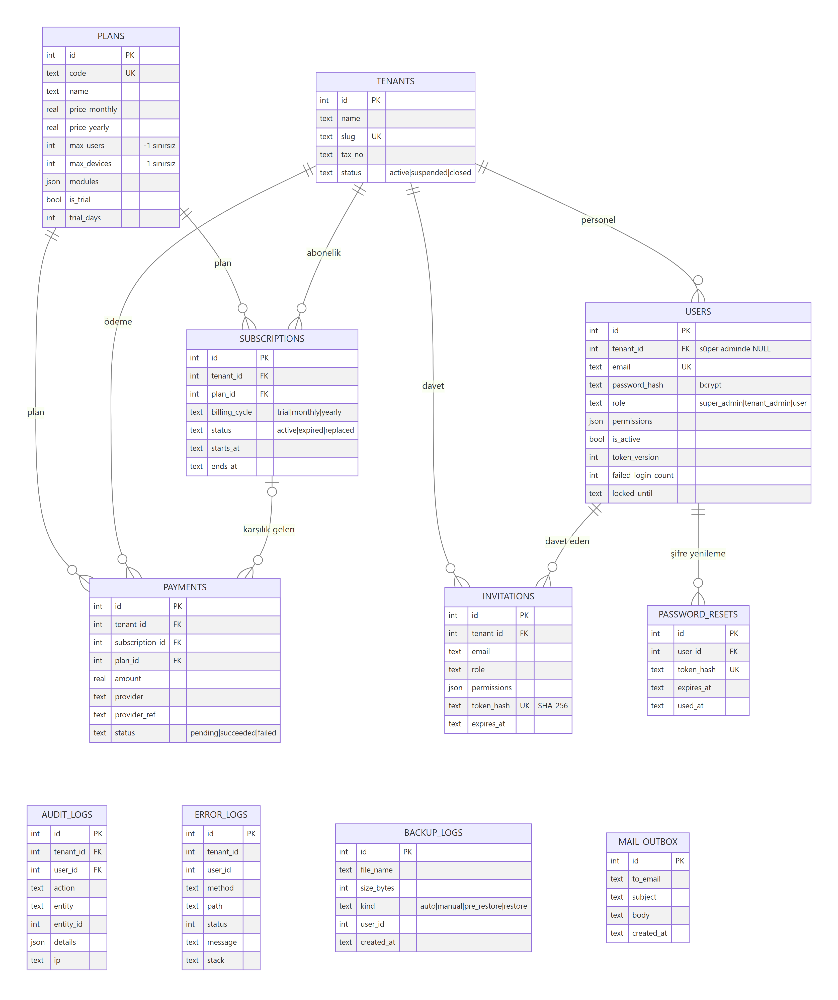

# Telefon Stok ve Satış Takip Sistemi: Teknik Doküman

## 1. Amaç ve kapsam

Sistem, telefon alım satımı yapan işletmeler için çok kiracılı (multi-tenant) ve abonelik modelli bir web uygulamasıdır. Her işletme (kiracı) kendi stokunu, alış-satış-takas işlemlerini, müşteri ve tedarikçilerini, personelini ve raporlarını yönetir. Platform sahibi (Süper Admin) işletmeleri, planları ve limitleri yönetir, kullanım istatistiklerini ve günlükleri izler.

| Gereksinim | Karşılığı |
|---|---|
| Stok kaydı (marka, model, hafıza, renk, IMEI, seri no) | `devices` tablosu; IMEI Luhn kontrollü, işletme içinde benzersiz |
| Tekli / toplu giriş | Alış ekranında çok satırlı tablo ve Excel'den yapıştırma (CSV) |
| Barkod oluşturma / yazdırma | Her cihaza `TS########` Code128 barkodu; etiket sayfası tarayıcıdan yazdırılır |
| Durum takibi | `in_stock` → `reserved` → `sold` (rezervasyon müşteriye bağlanabilir) |
| IMEI / barkod ile hızlı arama | `GET /devices/lookup` ve okuyucu dostu arama kutusu (Enter ile) |
| Stok sayımı | Sayım oturumu, okutma, eksik ve beklenmeyen listesi, harekete yazma |
| Stok hareket geçmişi | `stock_movements`: her giriş, çıkış, rezerv, güncelleme ve sayım |
| Müşteri / tedarikçi | `customers`, `suppliers` |
| Alış, satış, takas; fiyat, tarih ve ödeme | `transactions` ve `transaction_items`; ödeme yöntemi, ödenen tutar, ödeme durumu |
| Takas bedeli | `net_amount = verilen cihazlar − alınan cihazlar` |
| Satışta stokun otomatik güncellenmesi | Satış aynı veritabanı işlemi içinde cihaz durumunu `sold` yapar |
| Cihaz bazında kâr / marj | `unit_price − unit_cost`; maliyet satış anında sabitlenir |
| Raporlama paneli | Panel, günlük/haftalık/aylık rapor, marka/model dağılımı, cihaz kârı |
| Filtreler | Tarih, IMEI, ürün, kullanıcı, işlem türü |
| Excel / PDF | `exceljs` ve `pdfkit` (Türkçe karakter için DejaVu Sans gömülü) |
| 3 rol ve yetkiler | `super_admin`, `tenant_admin`, `user` ve kullanıcı bazlı 10 ayrı yetki |
| Abonelik | Deneme, aylık, yıllık; kullanıcı, stok ve modül limitleri; süre dolunca salt okunur mod |
| Ödeme altyapısı | Soyut `PaymentProvider` ve `MockPaymentProvider` |
| Güvenlik | HttpOnly çerez, bcrypt, hesap kilitleme, şifre yenileme, RBAC, kiracı izolasyonu, CSRF, denetim kaydı |
| Yedekleme | Zamanlanmış ve manuel `VACUUM INTO` yedeği; arayüzden ve komut satırından geri yükleme |
| Eş zamanlılık | Koşullu UPDATE, `BEGIN IMMEDIATE` ve iyimser kilitleme (`version`) |
| Responsive arayüz | 860 px altında açılır menü, tek sütun düzen |

## 2. Teknoloji yığını

| Katman | Seçim | Gerekçe |
|---|---|---|
| Çalışma ortamı | Node.js 24 | Bilgisayarda kuruluydu; yerleşik `node:sqlite` ek kurulum gerektirmez |
| Web çatısı | Express 4 | Yaygın, sade, ara katman (middleware) modeli yetki zinciri için uygun |
| Veritabanı | SQLite (WAL modu, `node:sqlite`) | Sunucu kurulumu gerektirmez; tek dosya olduğu için yedeklenip geri yüklenmesi kolaydır |
| Doğrulama | zod | Şema tabanlı giriş doğrulama ve alan bazında hata mesajları |
| Kimlik | jsonwebtoken, bcryptjs, cookie-parser | JWT HttpOnly çerezde taşınır; şifreler bcrypt ile özetlenir (cost 10) |
| Güvenlik başlıkları | helmet, express-rate-limit | CSP ve benzeri başlıklar; IP bazlı deneme sınırı |
| Dışa aktarma | exceljs, pdfkit, dejavu-fonts-ttf | Sunucu tarafında xlsx ve PDF üretimi |
| Arayüz | React 18, React Router 6, Vite 6 | Tek sayfa uygulama, hızlı derleme |
| Grafik / barkod | Recharts, JsBarcode | Panel grafikleri, Code128 SVG barkod |
| Test | `node:test` ve supertest | Ek test çatısı gerektirmeden HTTP düzeyinde uçtan uca API testleri |

## 3. Mimari



Uygulama iki katmanlı bir istemci-sunucu yapısındadır.

- **İstemci (client/)**: React SPA. Menü ve butonlar kullanıcının rolüne, yetkilerine ve planındaki modüllere göre gösterilir. Bu yalnızca kullanım kolaylığı içindir; **asıl yetki kontrolü sunucudadır.**
- **Sunucu (server/)**: Express REST API. Derlenmiş arayüzü de aynı porttan sunar (`client/dist`).

Sunucu klasör yapısı:

```
server/src/
  app.js            Express uygulaması, ara katman zinciri, rota bağlama
  server.js         Dinleme ve otomatik yedek zamanlayıcısı
  config.js         Ortam değişkenleri, JWT anahtarının üretilmesi / okunması
  db/schema.sql     Tablo, indeks ve kısıtlar
  db/index.js       Bağlantı, tx() (BEGIN IMMEDIATE) yardımcıları
  db/seed.js        Deterministik demo verisi
  middleware/       auth.js (oturum, rol, kiracı, yetki, modül, abonelik, CSRF), errorHandler.js
  routes/           auth, profile, superadmin, business, devices, transactions, reports,
                    stockCounts, customers, suppliers (partyRouter ortak CRUD)
  services/         inventory (stok iş kuralları), subscription, backup, exporter,
                    filters (rapor filtreleri), audit, mail, payment/
  utils/            common (hata sınıfı, tarih, IMEI), schemas (zod), permissions
```

### İstek yaşam döngüsü

İşletme verisine giden her istek aşağıdaki zincirden geçer (`app.js`):

1. `helmet`, JSON ayrıştırma ve çerez okuma
2. `requireCsrfHeader`: değişiklik yapan istekte `X-Requested-With: fetch` başlığı aranır
3. `authenticate`: JWT doğrulanır; kullanıcı **her istekte veritabanından** okunur; `is_active`, `token_version` ve işletmenin `status` alanı kontrol edilir
4. `requireTenant`: süper admin iş verisine erişemez; `req.tenantId = req.user.tenant_id`
5. `requireActiveSubscription`: abonelik süresi dolduysa yalnızca GET isteklerine izin verilir (402)
6. Rota düzeyinde `requireModule('trade')` ve `requirePermission('trade.create')`
7. Rota içinde zod doğrulaması, ardından tüm sorgular `WHERE tenant_id = ?` ile çalışır
8. `errorHandler`: hata yanıtı biçimlendirilir; 5xx, 402, 403 ve 409 hataları `error_logs` tablosuna yazılır

Satış akışının sıralı diyagramı:



## 4. Veri modeli

ER diyagramı okunabilirlik için iki parçadır:

**İş verisi** (her tabloda `tenant_id` bulunur):



**Platform, kimlik, abonelik ve günlükler:**



Tüm tabloların tek parça hâli: `diagrams/er.png`. Kaynaklar: `docs/diagrams/*.mmd` (Mermaid). Tam şema: `server/src/db/schema.sql`.

Tasarım kararları:

- **Paylaşımlı şema ve `tenant_id`**: İş verisi tutan her tabloda `tenant_id` vardır ve kiracıya ait sorguların tamamı bu sütunla filtrelenir. Yüzlerce küçük işletme için ayrı veritabanından daha ekonomiktir. Benzersizlik kısıtları da kiracı kapsamındadır: `UNIQUE(tenant_id, imei)` ve `UNIQUE(tenant_id, barcode)`. Böylece aynı IMEI iki farklı işletmede bulunabilir, aynı işletmede iki kez bulunamaz.
- **İşlem başlığı ve kalemleri**: `transactions` (alış, satış, takas) ile `transaction_items` (yön `in` / `out`) ayrıdır. Takas tek bir işlemde hem giren hem çıkan kalem içerir.
- **Maliyetin sabitlenmesi**: `transaction_items.unit_cost`, satış anındaki maliyeti saklar. Cihaz ileride yeniden alınsa da geçmiş satışın kârı değişmez.
- **Aynı cihazın geri alınması**: Daha önce satılmış bir IMEI tekrar alınırsa (müşteri cihazı geri satarsa veya takasa verirse) yeni kayıt açılmaz. Mevcut kayıt yeniden stoka alınır ve cihazın tüm geçmişi tek yerde kalır.
- **Denetim izi**: `stock_movements` cihaz düzeyinde, `audit_logs` kullanıcı ve işlem düzeyinde tutulur.
- **Para birimi**: Tutarlar TL olarak `REAL` tipinde saklanır ve sunucuda 2 haneye yuvarlanır (`money()`).

## 5. Roller ve yetkilendirme

| Rol | Kapsam |
|---|---|
| Süper Admin (`super_admin`, `tenant_id = NULL`) | `/api/admin/*`: işletme oluşturma, etkinleştirme, askıya alma, kapatma; plan ve limit yönetimi; manuel plan atama; istatistikler, işlem günlükleri, hata kayıtları, yedekleme. **İşletmelerin stok ve satış verisine erişemez.** |
| İşletme Admini (`tenant_admin`) | Kendi işletmesindeki tüm iş verisi ve `/api/business/*`: profil, personel daveti, rol ve yetki atama, devre dışı bırakma, faaliyet geçmişi, abonelik ve ödeme |
| Kullanıcı (`user`) | Yalnızca atanmış yetkiler: `stock.view`, `stock.edit`, `stock.count`, `purchase.create`, `sale.create`, `trade.create`, `customer.manage`, `supplier.manage`, `report.view`, `report.export`. Profilini ve şifresini yönetir. `report.view` yetkisi yoksa işlem listesinde yalnızca kendi işlemlerini görür. |

Ek kurallar:

- Bir personelin rolü, yetkileri veya aktifliği değiştirildiğinde `token_version` artırılır ve kişinin açık oturumları anında geçersiz olur.
- İşletme admini kendi yönetici yetkisini kaldıramaz. İşletmede en az bir aktif admin kalmak zorundadır.

## 6. Çok kiracılık ve veri izolasyonu

- Kiracı kimliği **asla istemciden alınmaz**. Yalnızca oturumdaki kullanıcının `tenant_id` değeri kullanılır.
- Kayıt ID ile istendiğinde sorgu `WHERE id = ? AND tenant_id = ?` biçimindedir. Başka işletmenin kaydı **404** döner, böylece kaydın varlığı bile sızdırılmaz.
- Satış veya alışta başvurulan müşteri ve tedarikçinin aynı işletmeye ait olduğu `ensureParty()` ile kontrol edilir.
- Askıya alınan veya kapatılan işletmenin kullanıcıları bir sonraki istekte 403 alır ve giriş yapamaz.
- `test/tenant-isolation.test.js` bu kuralları iki işletmeli senaryoyla doğrular (bkz. §11).

## 7. Abonelik ve ödeme

- `plans`: aylık ve yıllık fiyat, `max_users`, `max_devices` (-1 sınırsız), `modules` (JSON), deneme planı ve süresi.
- `subscriptions`: işletme başına dönemler. Yeni dönem başlarken önceki dönem `replaced` olur. Aynı plan yenilenirse kalan süre korunur.
- **Limitler**: Personel daveti ve pasif kullanıcının yeniden aktifleştirilmesi kullanıcı limitini, alış ve takas stok limitini (satılmamış cihaz sayısı) kontrol eder. Aşımda yanıt `403 LIMIT_EXCEEDED` olur.
- **Modüller**: `stock`, `sales`, `trade`, `reports`, `export`, `barcode`, `stock_count`. Planda olmayan modülün API'si `403 MODULE_NOT_IN_PLAN` döner, arayüz de menüyü gizler.
- **Süre dolumu**: Süresi dolan işletme **salt okunur** moda geçer: GET serbest, yazma işlemleri 402. Admin abonelik sayfasından yenileyebilir; arayüzde uyarı bandı gösterilir. Deneme bitimine 5 gün kala da uyarı çıkar.
- **Ödeme soyutlaması**: `services/payment/PaymentProvider.js` arayüzü `charge()` ve `refund()` yöntemlerini tanımlar. Kayıt tablosu `payment/index.js` içindedir; `PAYMENT_PROVIDER` ortam değişkeniyle seçilir. Kart bilgisi sunucuya gelmez; sağlayıcının ödeme formundan dönen tek kullanımlık `paymentToken` gönderilir. Akış: `payments` tablosuna `pending` kaydı yazılır → sağlayıcı çağrılır → `succeeded` ise abonelik başlatılır ve ödeme kaydına bağlanır, `failed` ise sebep yazılır.
- Projede **gerçek bir ödeme sağlayıcısı entegre değildir**. `MockPaymentProvider`, `tok_fail` belirtecinde reddeder, diğer durumlarda başarılı döner.

## 8. Güvenlik önlemleri

| Tehdit | Önlem |
|---|---|
| Oturum çalınması (XSS) | JWT HttpOnly çerezde; JavaScript erişemez. helmet CSP başlıkları |
| CSRF | `SameSite=Strict` çerez ve değişiklik yapan isteklerde zorunlu özel başlık (CORS açık değil) |
| Parola sızıntısı | bcrypt (cost 10); parola özeti hiçbir yanıtta dönmez |
| Kaba kuvvet | Hesap başına 5 hatalı denemede 15 dk kilit; IP başına 15 dk'da 100 istek sınırı (auth uç noktaları) |
| Kullanıcı tespiti | Şifre yenileme yanıtı her durumda aynı; kullanıcı yoksa da sahte hash karşılaştırması yapılır |
| Eski oturumlar | `token_version`: şifre değişimi, sıfırlama, rol/yetki değişimi ve devre dışı bırakma tüm oturumları düşürür |
| Token sızıntısı | Şifre sıfırlama ve davet tokenları veritabanında SHA-256 özetiyle saklanır, süreli ve tek kullanımlıktır |
| Yetki aşımı | Tüm kontroller sunucu ara katmanında; arayüz gizlemesi yalnızca kolaylık içindir |
| SQL enjeksiyonu | Tüm sorgular parametreli (`?`); dinamik sütun adları yalnızca sabit listelerden gelir |
| Geçersiz veri | zod şemaları; IMEI için Luhn kontrolü |
| Yol geçişi (yedek geri yükleme) | Dosya adı katı bir regex ile doğrulanır; yedek dosyası açılıp tablo varlığı kontrol edilir |
| İzlenebilirlik | `audit_logs` (giriş, hatalı giriş, tüm iş işlemleri, yönetim işlemleri, dışa aktarma, IP); `error_logs` |

JWT imzalama anahtarı `JWT_SECRET` ortam değişkeninden okunur. Değişken tanımlı değilse ilk çalıştırmada rastgele üretilip `server/data/.jwt-secret` dosyasına yazılır; kaynak kodda anahtar yoktur.

## 9. Eş zamanlılık

Aynı cihazın iki kez satılmasını engellemek için birden fazla katman birlikte çalışır:

1. **Koşullu güncelleme (asıl koruma)**:
   ```sql
   UPDATE devices SET status='sold', ...
   WHERE id=? AND tenant_id=? AND (status='in_stock' OR (status='reserved' AND (reserved_for IS NULL OR reserved_for IS ?)))
   ```
   Etkilenen satır sayısı 1 değilse işlem `409 DEVICE_NOT_AVAILABLE` ile reddedilir. Kontrol ve güncelleme tek bir SQL ifadesinde olduğu için arada başka bir isteğin araya girme penceresi yoktur.
2. **Atomik işlem**: Her alış, satış ve takas `BEGIN IMMEDIATE … COMMIT` içinde yürür. Çok kalemli satışta bir cihaz müsait değilse önceki kalemler de geri alınır. `IMMEDIATE`, yazma kilidini en başta alır; aynı veritabanını kullanan ikinci bir süreç çakışan yazma başlatamaz (`busy_timeout = 5000 ms`).
3. **İyimser kilitleme**: Cihaz düzenlemede istemci `version` alanını gönderir. Kayıt arada değiştiyse yanıt `409 STALE_VERSION` olur.
4. **Benzersizlik kısıtı**: `UNIQUE(tenant_id, imei)` aynı IMEI'nin eş zamanlı iki alışta iki kez eklenmesini veritabanı düzeyinde engeller.

Not: Node.js tek iş parçacıklıdır ve `node:sqlite` senkron çalışır. Bu nedenle tek bir sunucu sürecinde istekler zaten sırayla veritabanına ulaşır. Yine de istemcinin elindeki veri bayat olabilir (iki kasada aynı cihazın sepette olması gibi) ve ileride birden fazla süreç çalıştırılabilir. Bu yüzden koruma uygulama belleğinde değil, veritabanı ifadesinde yapılmıştır. Test, 10 eş zamanlı satış isteğinden yalnızca birinin başarılı olduğunu doğrular.

## 10. Yedekleme ve geri yükleme

- **Otomatik**: Sunucu açılışta ve her `BACKUP_INTERVAL_HOURS` saatte (varsayılan 6) bir `VACUUM INTO` ile tutarlı bir kopya alır. Bu yöntem çalışan veritabanını kilitlemeden anlık görüntü üretir. Son `BACKUP_KEEP` (varsayılan 14) otomatik yedek tutulur.
- **Manuel**: Süper Admin panelinden veya `npm run backup` komutuyla.
- **Geri yükleme**: Panelden veya `npm run restore -- <dosya>` komutuyla. Önce mevcut durumun `pre_restore` yedeği alınır; ardından bağlantı kapatılır, dosya kopyalanır ve bağlantı yeniden açılır. Tüm adımlar `backup_logs` tablosuna yazılır.
- Geri yükleme tüm platform veritabanını kapsar; işletme bazında geri yükleme yoktur.

## 11. Testler

```
npm test     (server/ altında node:test, 49 test)
```

| Dosya | Doğrulanan |
|---|---|
| `tenant-isolation.test.js` | Başka işletmenin cihaz, müşteri, işlem ve personeline erişim 404; satış yapılamaz; `tenant_id` parametresi yok sayılır; raporlar yalnızca kendi verisi; IMEI benzersizliği kiracı kapsamlı |
| `rbac.test.js` | 401 / 403 senaryoları; CSRF; yetkisiz kullanıcı; rollerin birbirinin alanına girememesi; süper adminin iş verisine erişememesi; yetki değişince oturumun düşmesi; askıya alınan işletme |
| `concurrency.test.js` | Çift satış 409; 10 eş zamanlı satıştan 1 başarı; çok kalemli satışta geri alma; rezervasyon kuralı; iyimser kilit; eş zamanlı aynı IMEI alışı |
| `subscription.test.js` | Stok ve kullanıcı limitleri; modül kısıtı; süre dolunca salt okunur mod; başarısız / başarılı ödeme; plan atama |
| `auth.test.js` | Çerez bayrakları; hesap kilitleme; şifre yenileme; davet akışı; self servis kayıt |
| `business.test.js` | Luhn; toplu alış ve barkod; satışta kâr/marj; takas bedeli; geri alınan IMEI; rapor toplamlarının kalemlerle tutarlılığı; Excel/PDF; stok sayımı; yedek alma ve geri yükleme |

`clock.test.js` demo saatinin (DEMO_NOW) yalnızca değişken verildiğinde devreye girdiğini doğrular. Her test dosyası geçici bir klasörde boş bir veritabanıyla çalışır; demo verisini etkilemez.

## 12. Bilinen sınırlamalar ve geliştirme önerileri

- **Demo saati**: Demo verisi ve ekran görüntüleri `DEMO_NOW=2026-08-14T15:30:00` ile (staj dönemi içinde) üretilmiştir. `utils/common.js` içindeki `clockNow()` tüm "şimdi" hesaplarının tek kaynağıdır; arayüz de tarih varsayılanlarını `/api/meta` içindeki `serverNow` değerine göre hizalar. Değişken tanımlı değilse gerçek saat kullanılır.
- **E-posta**: Gerçek SMTP yoktur. Şifre yenileme ve davet iletileri `mail_outbox` tablosuna ve sunucu konsoluna yazılır. Davet bağlantısı demo kolaylığı için arayüzde de gösterilir.
- **Ödeme**: Yalnızca test (mock) sağlayıcısı vardır. Gerçek entegrasyonda sağlayıcı adaptörü ve ödeme sonucunu doğrulayan webhook uç noktası eklenmelidir.
- **Veritabanı**: SQLite tek sunucu için uygundur. Yatay ölçekleme gerekirse PostgreSQL'e geçilmeli ve kiracı izolasyonu satır düzeyi güvenlik (RLS) ile pekiştirilmelidir. Şema standart SQL'e yakındır. `node:sqlite` Node 24'te hâlâ "deneysel" etiketlidir; uyarı başlatma betiğinde gizlenir.
- **HTTPS**: Yerel ortamda HTTP kullanılır. Üretimde ters vekil (nginx vb.) arkasında `COOKIE_SECURE=true` ile çalıştırılmalıdır.
- **Para tipi**: Tutarlar `REAL` olarak saklanır ve 2 haneye yuvarlanır. Muhasebe düzeyinde hassasiyet için kuruş cinsinden tam sayıya geçilebilir.
- **İki faktörlü doğrulama**, iade/garanti süreçleri ve e-fatura entegrasyonu kapsam dışıdır.
